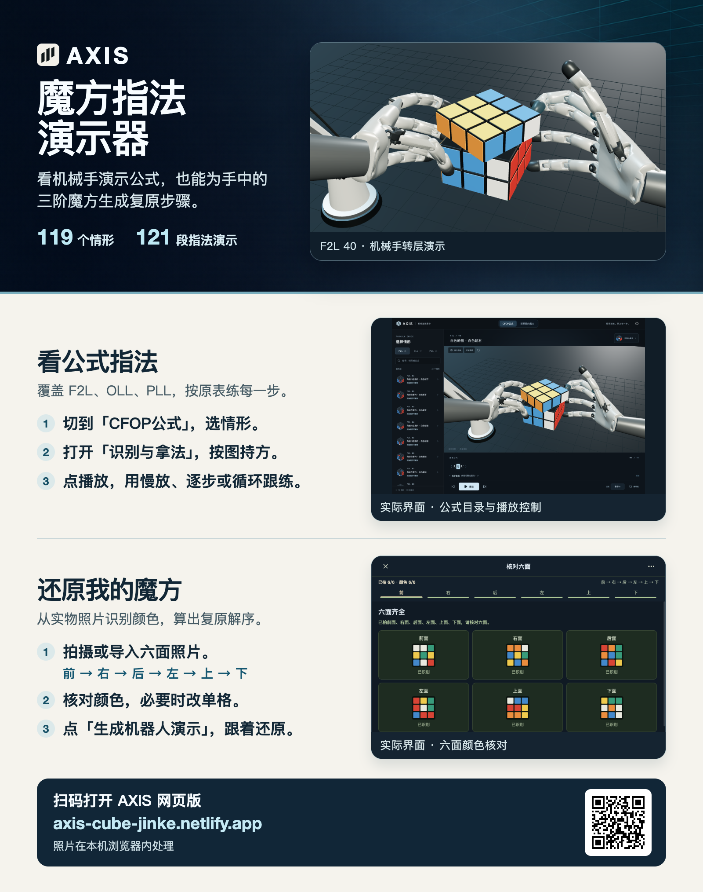

# AXIS · CFOP 指法演示器

在固定的机械展台上，按原表公式观察双手机械指法。选择情形、核对拿法，再慢放、逐步观察或循环动作组。

**AXIS U9 r1 手机可用性修复版已上线。** 公式库开放 119 个情形和 121 段机械指法演示，保留主公式、替代式及原表指法。个人复原支持拍照或导入六面照片、核对颜色和观看白色机械手复原。

[打开 AXIS](https://axis-cube-jinke.netlify.app/) · [还原我的魔方](https://axis-cube-jinke.netlify.app/solve) · [版本与验收记录](RELEASES.md)



## 使用方式

- GAN 原表 119 个情形、121 条主/替代公式，保留原始编号、括号分组、重复动作、半圈方向与手指颜色。当前开放全部 121 段演示。
- 桌面左侧目录独立滚动；手机用底部抽屉选择公式。列表和说明滚动不影响展台的位置、大小或视角。
- 控制包括播放/暂停、上一步/下一步、0.6×／1×／2×、动作组循环、视角复位与手部透视。切换公式停在起始握姿，不自动播放。
- 情形图、拿法、原表公式与完成检查始终可读。三维或动作资源加载失败时禁用演示，避免在新公式标题下播放旧动作。

原表蓝字为左食指、红字为右拇指、橙字为无名指。原表没有明确的左右手、支撑与接力步骤，由教学编排补全并在动作记录中区别标注。机械手是教学可视化，不代表实体机器人的执行能力。

在「还原我的魔方」中，按前、右、后、左、上、下录入六面。核对每面颜色，必要时改单格，再生成复原演示。照片在浏览器内处理，旧链接可继续定位原表情形。

## 本地运行

使用 Node.js 24。安装依赖、构建 U9 网页并启动静态预览。

```sh
npm ci
node scripts/wuji-release/build.mjs --version axis-u9-r1
npm exec -- vite preview --config release-u9-r1.vite.config.ts --outDir output/axis-netlify-u9-release-r1/site --host 127.0.0.1 --port 4173 --strictPort
```

[本地公式库](http://127.0.0.1:4173/) · [本地个人复原](http://127.0.0.1:4173/solve)

如需复现上一版，在干净目录执行 `node scripts/wuji-release/build.mjs --version axis-u8-r1`，独立输出位于 `output/axis-netlify-u8-release-r1`。

公式深链接示例为 `/library/cfop/gan-f2l-40`。PLL 01 和 PLL 02 的替代式使用 `?variant=1`。

## 验证与目录

```sh
npm exec -- vitest run src/wuji-solve-u9-r1/flow.test.ts
```

- `src/wuji-exhibition-u9-r1/` 提供当前展台和手机录入布局，`src/wuji-solve-u9-r1/` 管理合法局面、动作生成及失败后的重试。展台沿用 U8 的公式与 C114 的动作。
- `src/wuji-samples/` 和 `art/wuji-teaching/` 包含握姿、指尖侧拨、动作编排和校准数据。
- `public/models/wuji-teaching/` 包含网页使用的白色机械手 GLB、模型说明和许可。
- `src/core/`、`src/wuji-solve-v1/` 和 `vendor/` 提供照片识别、魔方状态与 CFOP 求解。
- `release/axis-u9-r1-sources.json` 与 U8 对应的输入清单分别固定两版构建与产物身份。

## 部署

`netlify.toml` 使用 Node.js 24，构建命令与上面的 U9 本地构建相同，发布目录为 `output/axis-netlify-u9-release-r1/site`。构建校验源码输入与正式发布产物，逐文件清单位于发布目录的上一级。`scripts/wuji-release/prepare.mjs` 按清单导出发布文件，`scripts/wuji-release/check.mjs` 核对线上文件、路由与响应头。

正式部署、回退编号、实测范围及真机待验项见 [版本与验收记录](RELEASES.md)。

## 来源与许可

模型、求解器与测试照片的来源、固定版本、修改说明和许可见 [THIRD_PARTY.md](THIRD_PARTY.md)，原始许可随对应目录保留。项目原创代码目前未指定开源许可证；公开可见不等同于授予额外使用许可。
